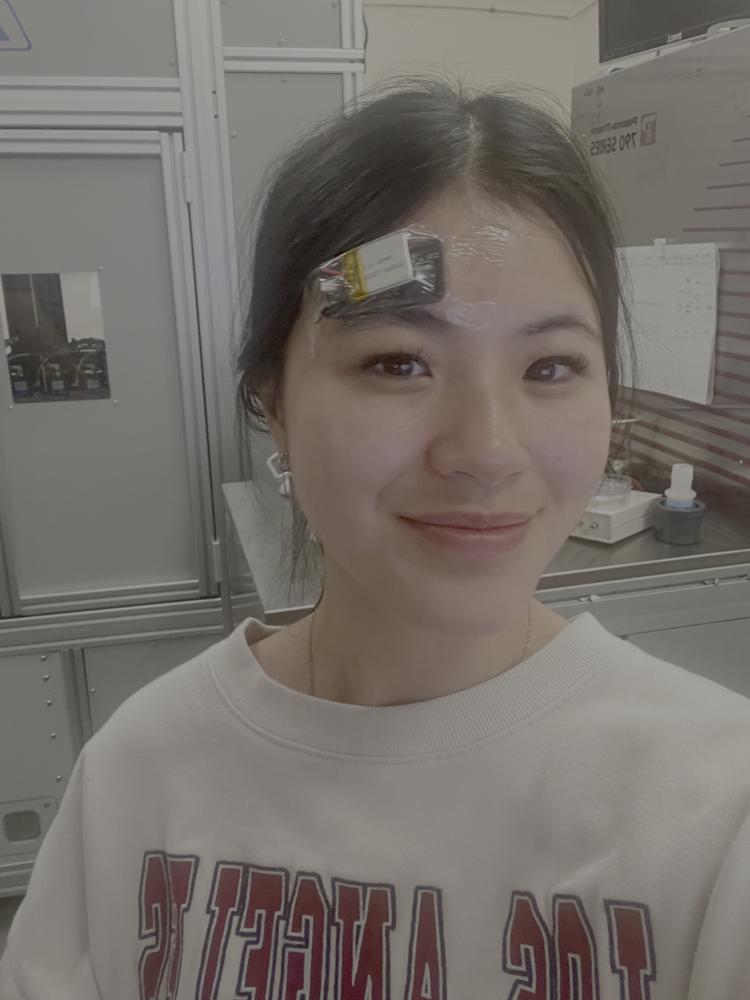
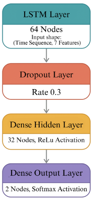

# Cognitive-State-Recognition-Using-Deep-Learning
Developed an LSTM-based deep learning model to classify cognitive states from time-series neural signals as part of the AI-Driven Resilient Health and Biological Systems Research Program.

Note: Source code and datasets are not included in this repository due to research and intellectual property restrictions. This repository documents the project methodology, architecture, and results.

## Overview
The Florida International University's Flexible Electronics Lab is working on a small, flexible, wearable device that can be placed on the forehead to collects functional near-infrared spectroscopy (fNIRS) data to monitor cognitive activity using non-invasive techniques suitable for daily activities.

The device was tested by recording participants conducting periods of three-digit math, two-digit math, and resting. 

To classify the signals received from the device, I developed a Long Short-Term Memory (LSTM) neural network for cognitive state classification using the collected time-series data, building an end-to-end machine learning pipeline for data preprocessing, model training, and evaluation.

## Research Poster 

## Machine Learning Pipeline

### Data Preprocessing
A preprocessing pipeline was built for the collected functional-Near Infrared Spectroscopy (fNIRS) data using NumPy, Pandas, and Scikit-Learn. The samples first go through smoothing, baseline correction, and z-score normalization. Each sample of 120-second recordings was then segmented into overlapping time windows for sequence-based modeling and the temporal features were extracted.

### Model Development
A LSTM-based model was developed using TensorFlow and Keras to classify the three mental-load categories: High, Moderate, Resting. 

The model architecture consiss of three stacked LSTM layers followed by dense classification layers with ReLU and Softmax activations to capture temporal dependencies and perform multi-class prediction. 

Training incorporated early stopping to reduce overfitting, and model performance was evaluated using group 4-fold cross-validation, where each subject group served as the test set once, providing a robust assessment of generalization.

### Results

Achieved 70% cross-validated accuracy across 2,000+ samples, demonstrating the model's ability to distinguish between different cognitive states

### Technologies Used

Programming Language: Python
Machine Learning: TensorFlow, Keras, Scikit-Learn
Data Processing: NumPy, Pandas
Visualization: Matplotlib

